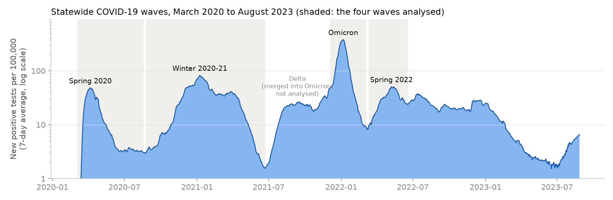
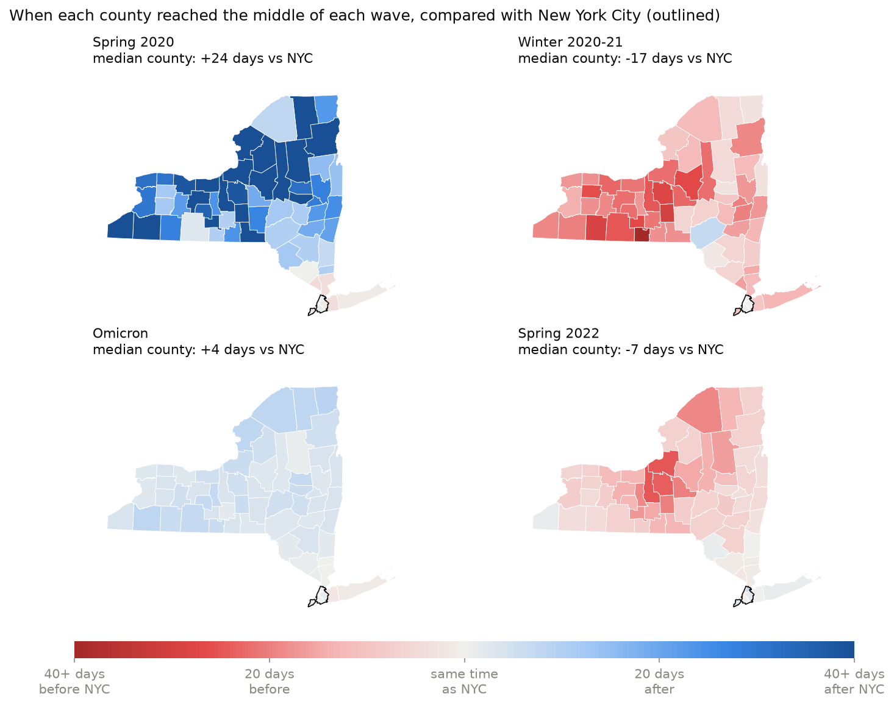
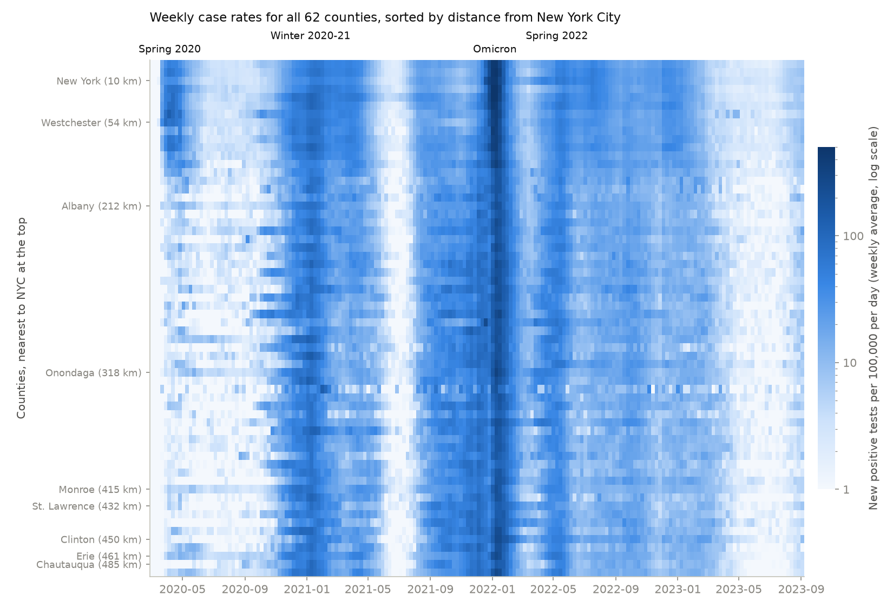

# How COVID-19 Waves Travelled Across New York State, 2020–2023

Did each COVID-19 wave start in New York City and spread outward across the state? Using daily positive tests for all 62 counties from March 2020 to August 2023, I measured when each county reached the middle of each wave compared with NYC, and how that related to its distance from the city.



Methods:
- Downloaded daily COVID-19 testing data for every county from the New York State Department of Health API, and yearly county population estimates from the US Census Bureau, checking that all 62 counties match across sources before anything is saved
- Converted daily positive tests into 7-day average rates per 100,000 residents, using each year's population estimate
- Found the statewide waves from the peaks in the statewide curve with `scipy`, and kept the four largest
- For each county and wave, found the midpoint: the date by which half of that county's cases in the wave had been reported
- Measured each county's distance from NYC with `geopandas`, and compared timing with distance using Spearman correlation and a robust (Theil-Sen) trend, cross-checked against peak dates

Findings:
- Only the first wave spread outward from NYC. In spring 2020 the typical county reached its midpoint 24 days after the city, about 9.5 days later for every 100 km of distance
- In winter 2020–21 and spring 2022, upstate went first: the typical county reached its midpoint 17 and 7 days before NYC
- Omicron hit almost everywhere at once: the typical county was just 4 days behind NYC
- These are positive tests, not infections, so differences in testing access between counties and over time can shift the timing





The `maps/` folder also has two interactive maps to open in a browser: cumulative incidence by county, with values on hover, and an animated map of weekly case rates.

Run it:
```bash
pip install -r requirements.txt

# download and check the data
python fetch_data.py

jupyter notebook ny_covid_waves.ipynb
```

Data sources:
- New York State Department of Health: [Statewide COVID-19 testing by county](https://health.data.ny.gov/Health/New-York-State-Statewide-COVID-19-Testing/xdss-u53e)
- US Census Bureau: [County population estimates, 2020–2023](https://www.census.gov/data/tables/time-series/demo/popest/2020s-counties-total.html)
- Cornell University Geospatial Information Repository: [New York county boundaries](https://cugir.library.cornell.edu/catalog/cugir-007865)
